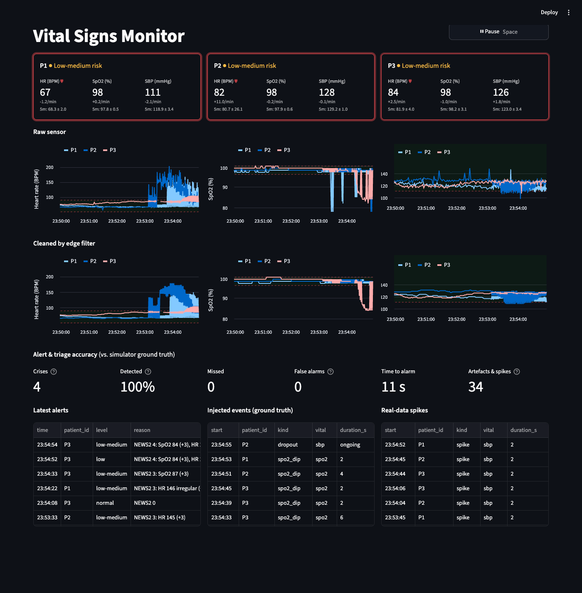
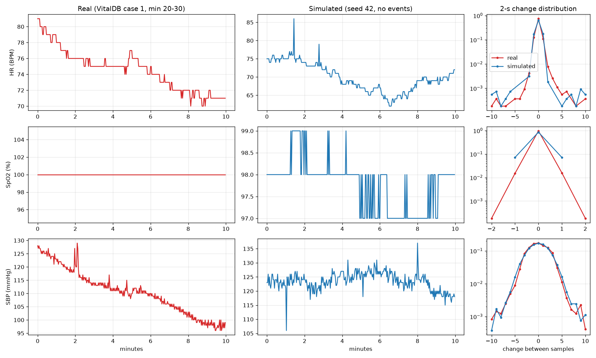
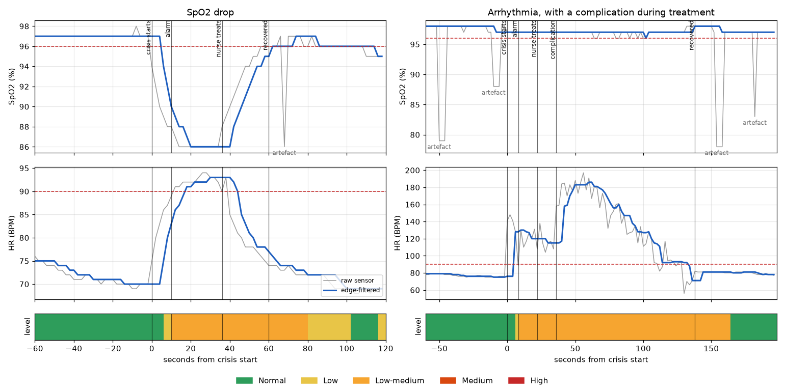
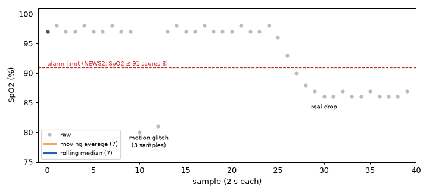
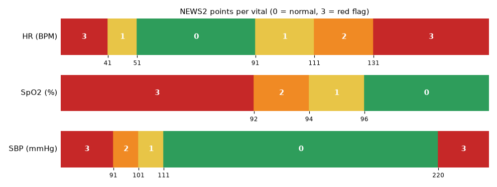

[فارسی](README.md) | **English**

# Vital Signs Monitor

An IoMT prototype: it simulates HR, SpO2 and blood pressure (SBP) for several patients, cleans the signal at the edge, scores each patient with **NEWS2** to set a risk level, and shows everything on a live dashboard.



```bash
python3 -m venv .venv && source .venv/bin/activate
pip install -r requirements.txt
python -m monitor.run          # terminal 1: 3 patients, a reading every 2 s
streamlit run dashboard.py     # terminal 2: http://localhost:8501
```

`--patients N`, `--interval S`, `--seed N` (same seed, same run). Tests: `python -m unittest`. Figures: `python -m monitor.compare` and `python -m monitor.figures`.

---

## 1. Built from real data

We did not make up the signals: we modelled them on a real recording. **VitalDB case 1** is about 3 hours of a surgical patient's HR, SpO2 and arterial SBP, sampled every 2 s (the same rate as our simulator).

Looking at the real data, each signal is made of three parts:

```
reading = slow level  +  jitter  +  spikes
          (drifts over minutes)  (small noise every sample)  (one-sample jumps)
```

**Spikes and jitter are fitted from the real data**, so the simulated chart has the same texture as the real one:

| Parameter | How it's measured in the real data | HR | SpO2 | SBP |
|---|---|---|---|---|
| Jitter (`jitter_sd`) | Neighbouring changes cancel out: $\mathrm{cov}(d_t, d_{t+1}) = -\sigma^2$ | 0 | 0.09 % | 1.56 mmHg |
| Spike rate | A sample more than 5 units from the median of its 7 neighbours | ~5 / h | none | ~34 / h |
| Spike size | The real sizes, replayed as they were | ±6–13 | — | ±6–9, a few down to −43 |

The **slow level** is an assumption: in this surgery the trend comes from the operation (SBP 180 → 98), not from how a stable patient drifts. So we state it: the level wanders about ±4 BPM / ±1 % / ±4 mmHg around a baseline and takes ~5 minutes to come back.

```math
\text{level}_{t+1} = \text{level}_t + \underbrace{k\,(\text{baseline}-\text{level}_t)}_{\text{pull home}} + \mathcal{N}(0,\sigma_{\text{drift}}),\qquad
\text{reading}_t = \text{round}\big(\text{level}_t + \mathcal{N}(0,\sigma_{\text{jitter}}) + \text{spike}\big)
```

with $k = 2\,\text{s} / 300\,\text{s}$. Baselines are drawn from HR 65–80, SpO2 98–99, SBP 120–130, well inside NEWS2's normal band.

**Real (red) vs simulated (blue).** Absolute levels differ on purpose (the real patient is in surgery). What should match is the texture, and the right-hand column shows the distribution of 2-second changes overlapping almost exactly:



The spikes in the simulated chart (e.g. HR 86 at minute 1.5, SBP 106 at minute 1) are **deliberate**: they are the real data's spikes, replayed so the filter has to deal with them. Each one is logged as a `spike` event.

## 2. Injecting events

On top of the normal signal, each patient gets about one **crisis** every 3 minutes and one **artefact** every 30 seconds:

| Event | What happens | Should it alarm? |
|---|---|---|
| `spo2_drop` | SpO2 falls 10–15 points over ~20 s, HR rises 15–30 to compensate | ✅ |
| `arrhythmia` | HR jumps to 110–150 within a few beats and becomes irregular (±12 per beat) | ✅ |
| `worsening` | In 1 of 4 treatments, the patient gets worse during treatment (deeper crisis, SBP −15 to −25) | ✅ |
| `spo2_dip` | Artefact: SpO2 falsely drops 10–20 points for 1–3 samples (probe motion) | ❌ filter it |
| `dropout` | Artefact: one vital sends nothing for 2–5 samples (probe off) | ❌ |

**A crisis changes the body, an artefact only the reading.** A crisis moves the patient's level toward a crisis target, and the level stays there until someone treats it.

**The nurse in the loop.** As soon as the monitor shows an alarm level, a simulated nurse arrives 10–30 s later and pulls the patient back toward baseline (if no alarm comes, the nurse notices on rounds after 3 minutes). The worse the alarm, the harder the treatment (×1, ×1.5, ×2). So the length of each crisis depends on how fast our own system detects it.



*Left: an SpO2 drop. Alarm 10 s after onset, the nurse arrives, the patient recovers. The motion artefact right after (SpO2 86) never reaches the filtered line. Right: an arrhythmia with a complication during treatment. HR gets worse for a while before it comes back. The coloured strip is the triage level.*

**Why artefacts, when the real data already has spikes?** The real spikes are one sample long and only in HR and SBP; the real recording has **no** SpO2 spikes. But in practice the most common false alarm is SpO2 dropping because the probe moves, and it can last several samples. Without that artefact the filter would never be tested against the hardest case. Dropouts test what happens when the probe is off.

Every event is stored in the `events` table as **ground truth**. The detector never reads it. It is only used to grade the alarms.

## 3. Edge filter: rolling median

Each clean value is the **median of the last 7 raw readings** (14 s). It only looks at the past, so it runs live.



```
glitch:     97 97 97 [80 78 81] 97   → sorted: 78 80 81 [97] 97 97 97 → 97  ✅ ignored
real drop:  97 97 97 [86 86 86 86]   → sorted: 86 86 86 [86] 97 97 97 → 86  ✅ accepted
```

- A glitch of up to **3 samples** can never be the middle value, so it disappears completely.
- A real change is accepted once it lasts **4 samples (8 s)**, close to the 10–15 s alarm delay of real bedside monitors.

**Why not a moving average or EMA?** An average does not ignore an outlier; it spreads it out. A 3-sample dip of −17 pulls a 7-sample average down by about 7 points, and as the animation shows, crosses the alarm line: a false alarm. Making the average stronger (a longer window) also slows down real drops. The median **ignores** a short outlier, and still follows a step change sharply. It is also simple: no parameters to tune but the window length.

**Known limit:** a burst of 4 or more glitches within 14 s looks exactly like the start of a real drop and gets through (at most ~20 s in our runs).

Over the last 5 minutes of clean values, the mean, SD and trend (slope of a fitted line, per minute) are also computed and shown on the cards.

## 4. Decision engine: NEWS2

Instead of making up thresholds, we took them from **NEWS2** (National Early Warning Score 2, Royal College of Physicians), the early-warning score used on hospital wards. Each vital gets 0–3 points; we score the three we monitor, on the **clean** values:



The total sets the level:

| Level | Rule | Nurse? |
|---|---|---|
| 🟢 Normal | total 0 | — |
| 🟡 Low | total 1–4 | — |
| 🟠 Low-medium (**Warning**) | one vital scores 3 | ✅ |
| 🟠 Medium | total 5–6 | ✅ |
| 🔴 High (**Critical**) | total ≥ 7 | ✅ |

**Arrhythmia:** NEWS2 has no rhythm parameter, so AF at 115 BPM would only be Low. One rule is added: if the median jump between consecutive **raw** HR samples over the last 20 s is above 3 BPM (irregular rhythm) and HR already scores points, HR scores 3.

### Our policy

- **Go up at once.** The filter has already held the change for 8 s, so the level rises the moment a value enters a worse band.
- **Come down slowly, with two guards:**
  - **Hysteresis:** a vital's points go down only once the value is a margin clear of the band edge (5 BPM, 1 %, 5 mmHg). HR 90 ↔ 91 does not make the level flicker.
  - **30 s window:** the level steps down only to a level that held for the whole last 30 s, so a few normal-looking glitches can't end an alarm.
- **Probe off** = keep the last score; a loose probe can't silence an alarm.
- An alert is stored **only when the level changes**, with a readable reason: `NEWS2 5: SpO2 86 (+3), HR 104 (+1), SBP 108 (+1)`.

## 5. Results

On **27 simulated patient-hours** (3 seeds × 3 patients × 3 h), with the nurse in the loop:

| | Result |
|---|---|
| Crises | **423** (165 SpO2 drops, 184 arrhythmias, 74 worsenings) |
| Missed | **0**: 283 raised a new alarm, 140 began while the monitor was already alarming |
| Time to alarm | median **10 s** for SpO2 drops, **8 s** for arrhythmias |
| Artefacts and spikes filtered | 2168 artefacts + 1054 real spikes |
| False alarms | 130 of 476 alarms (27 %), all from a burst of SpO2 glitches |
| Crisis duration | SpO2 drop 34–136 s (median 58), arrhythmia 54–178 s (median 81) |
| Time per level | Normal 53 %, Low 9 %, Low-medium 36 %, Medium 2 %, High 0 % |

**The trade-off:** false alarms are the price of fast detection. A rise window would remove them, at the cost of later alarms:

| Rise window | False alarms | Median time to alarm |
|---|---|---|
| none (used) | 130 | 10 s |
| 16 s | 5 | ~24 s |
| 22 s | 0 | ~30 s |

High never happens: with 3 of NEWS2's 7 parameters, the worst simulated crisis reaches 6 (SpO2 3 + HR 2 + SBP 1).

---

<details>
<summary>Project structure</summary>

```
monitor/run.py        the loop: one reading per patient every 2 s
  ├─ simulator.py     sensor: patient, events, nurse
  ├─ model.py         fits jitter and spikes from the real data
  ├─ processing.py    edge: median filter + 5-minute stats
  ├─ triage.py        NEWS2, level, alerts
  └─ storage.py       SQLite (WAL) ──▶ dashboard.py (Streamlit)
```

The pipeline and the dashboard are two separate processes that share only the database.
</details>

**Data source:** VitalDB, CC BY 4.0. Lee HC et al. *VitalDB, a high-fidelity multi-parameter vital signs database in surgical patients.* Scientific Data 9, 279 (2022). [doi:10.1038/s41597-022-01411-5](https://doi.org/10.1038/s41597-022-01411-5)
