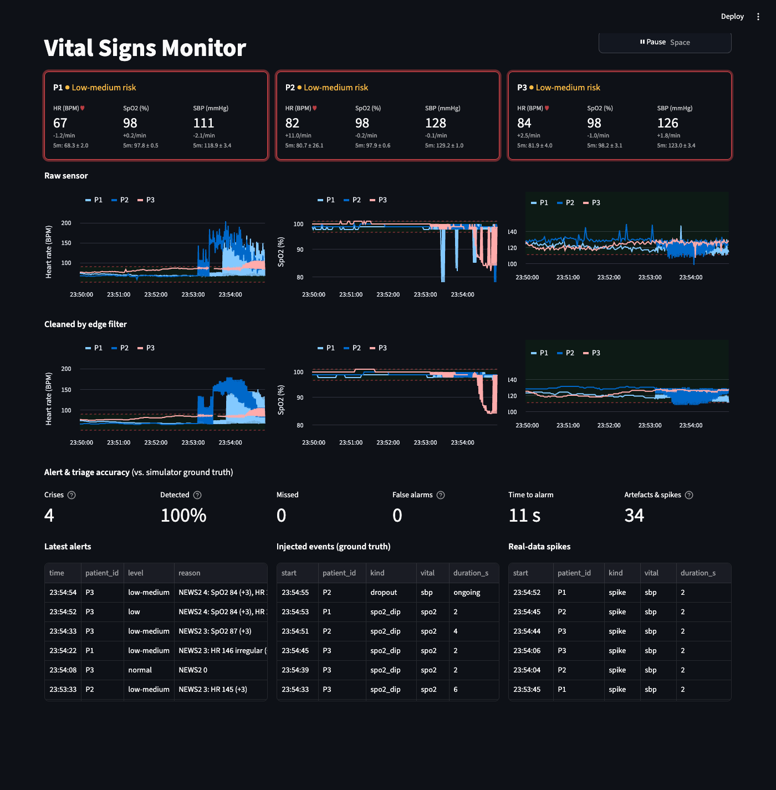
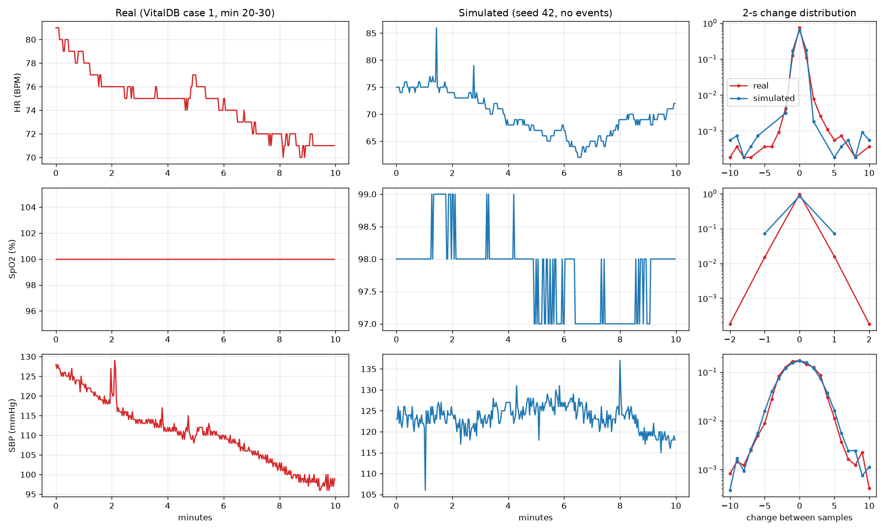
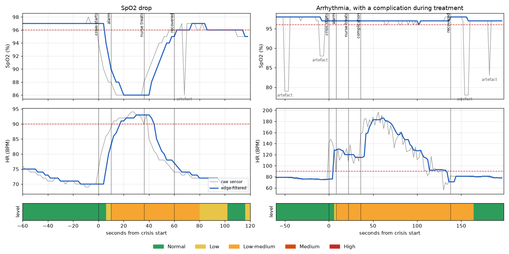
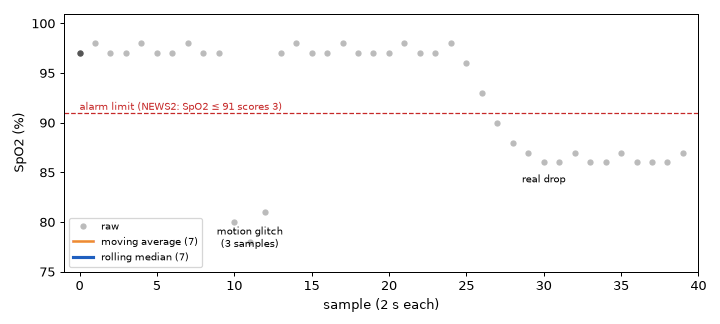
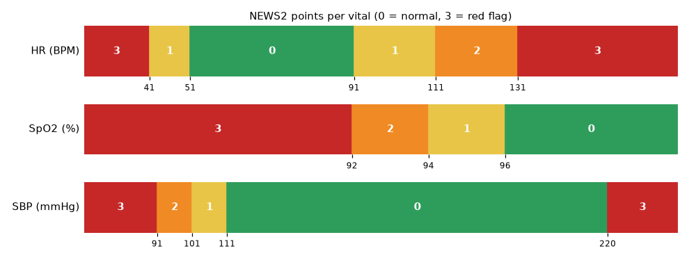

<div dir="rtl">

**فارسی** | [English](README.en.md)

# پایشگر علائم حیاتی

نمونهٔ اولیهٔ یک سامانهٔ IoMT: ضربان قلب (HR)، اکسیژن خون (SpO2) و فشار سیستولیک (SBP) چند بیمار را شبیه‌سازی می‌کند، سیگنال را در لبه (edge) تمیز می‌کند، با **NEWS2** به هر بیمار امتیاز و سطح خطر می‌دهد و همه را روی یک داشبورد زنده نشان می‌دهد.



</div>

```bash
python3 -m venv .venv && source .venv/bin/activate
pip install -r requirements.txt
python -m monitor.run          # ترمینال ۱: سه بیمار، هر ۲ ثانیه یک خوانش
streamlit run dashboard.py     # ترمینال ۲: http://localhost:8501
```

<div dir="rtl">

گزینه‌ها: `--patients N`، `--interval S`، `--seed N` (seed یکسان = اجرای یکسان). تست‌ها: `python -m unittest`. تصاویر: `python -m monitor.compare` و `python -m monitor.figures`.

---

## ۱. الگوبرداری از دادهٔ واقعی

سیگنال‌ها را از خودمان نساختیم؛ از روی یک ضبط واقعی الگو گرفتیم. **VitalDB case 1** حدود ۳ ساعت HR، SpO2 و SBP شریانی یک بیمار در حین جراحی است، با نمونه‌برداری هر ۲ ثانیه (همان نرخ شبیه‌ساز ما).

با نگاه به دادهٔ واقعی، هر سیگنال از سه بخش ساخته شده است:

</div>

```
reading = slow level  +  jitter  +  spikes
          (drifts over minutes)  (small noise every sample)  (one-sample jumps)
```

<div dir="rtl">

**نویز (jitter) و spikeها مستقیماً با fitting روی دادهٔ واقعی به دست آمده‌اند** تا نمودار شبیه‌سازی همان بافت نمودار واقعی را داشته باشد:

| پارامتر | چطور از دادهٔ واقعی درآمد | HR | SpO2 | SBP |
|---|---|---|---|---|
| نویز (`jitter_sd`) | تغییرهای پشت‌سرهم همدیگر را خنثی می‌کنند: $\mathrm{cov}(d_t, d_{t+1}) = -\sigma^2$ | 0 | 0.09 % | 1.56 mmHg |
| نرخ spike | نمونه‌ای که بیش از ۵ واحد با میانهٔ ۷ همسایه‌اش فاصله دارد | ~۵ در ساعت | ندارد | ~۳۴ در ساعت |
| اندازهٔ spike | همان اندازه‌های واقعی، عیناً بازپخش می‌شوند | ±6 تا 13 | — | ±6 تا 9، چندتا تا −43 |

**سطح آهسته** یک فرض است، نه حاصل fitting: در این جراحی روند سیگنال از خود عمل می‌آید (SBP از ۱۸۰ به ۹۸)، نه از نوسان طبیعی یک بیمار پایدار. پس صریحاً فرض کردیم سطح حدود ±4 BPM / ±1 % / ±4 mmHg دور یک baseline پرسه می‌زند و در حدود ۵ دقیقه برمی‌گردد.

</div>

```math
\text{level}_{t+1} = \text{level}_t + \underbrace{k\,(\text{baseline}-\text{level}_t)}_{\text{pull home}} + \mathcal{N}(0,\sigma_{\text{drift}}),\qquad
\text{reading}_t = \text{round}\big(\text{level}_t + \mathcal{N}(0,\sigma_{\text{jitter}}) + \text{spike}\big)
```

<div dir="rtl">

که در آن $k = 2\,\text{s} / 300\,\text{s}$. baseline هر بیمار از بازهٔ HR ۶۵–۸۰، SpO2 ۹۸–۹۹ و SBP ۱۲۰–۱۳۰ انتخاب می‌شود؛ یعنی کاملاً داخل محدودهٔ نرمال NEWS2.

**واقعی (قرمز) در کنار شبیه‌سازی (آبی).** سطح مطلق عمداً فرق دارد (بیمار واقعی زیر عمل است). آنچه باید یکی باشد بافت سیگنال است، و ستون راست نشان می‌دهد توزیع تغییرهای ۲ ثانیه‌ای تقریباً روی هم می‌افتند:



spikeهای نمودار شبیه‌سازی (مثلاً HR ۸۶ در دقیقهٔ ۱٫۵ یا SBP ۱۰۶ در دقیقهٔ ۱) **عمدی‌اند**: همان spikeهای دادهٔ واقعی‌اند که بازپخش شده‌اند تا فیلتر مجبور باشد با آن‌ها کنار بیاید. هر کدام به‌عنوان رویداد `spike` ثبت می‌شود.

## ۲. تزریق رویداد

روی سیگنال عادی، هر بیمار به‌طور میانگین هر ۳ دقیقه یک **بحران** و هر ۳۰ ثانیه یک **artifact** می‌گیرد:

| رویداد | چه اتفاقی می‌افتد | باید هشدار بدهد؟ |
|---|---|---|
| `spo2_drop` | SpO2 در حدود ۲۰ ثانیه ۱۰ تا ۱۵ واحد می‌افتد و HR برای جبران ۱۵ تا ۳۰ بالا می‌رود | ✅ |
| `arrhythmia` | HR در چند ضربان به ۱۱۰–۱۵۰ می‌پرد و نامنظم می‌شود (±12 در هر ضربان) | ✅ |
| `worsening` | در ۱ از ۴ درمان، بیمار حین درمان بدتر می‌شود (بحران عمیق‌تر، SBP ۱۵ تا ۲۵ پایین‌تر) | ✅ |
| `spo2_dip` | artifact: SpO2 برای ۱ تا ۳ نمونه به‌دروغ ۱۰ تا ۲۰ واحد می‌افتد (تکان پروب) | ❌ باید فیلتر شود |
| `dropout` | artifact: یک علامت برای ۲ تا ۵ نمونه هیچ مقداری نمی‌فرستد (پروب جدا شده) | ❌ |

**بحران بدن را تغییر می‌دهد، artifact فقط عدد را.** بحران سطح بیمار را به سمت یک هدف بحرانی می‌برد و سطح همان‌جا می‌ماند تا کسی درمانش کند.

**پرستار در حلقه.** به محض اینکه مانیتور به سطح هشدار برسد، یک پرستار شبیه‌سازی‌شده ۱۰ تا ۳۰ ثانیه بعد می‌رسد و بیمار را به سمت baseline برمی‌گرداند (اگر هشداری نیاید، در سرکشی بعد از ۳ دقیقه متوجه می‌شود). هرچه هشدار شدیدتر، درمان قوی‌تر (×1، ×1.5، ×2). پس طول هر بحران به سرعت تشخیص خودِ سیستم ما بستگی دارد.



*چپ: افت SpO2. هشدار ۱۰ ثانیه بعد از شروع، پرستار می‌رسد و بیمار برمی‌گردد. artifact حرکتی بلافاصله بعدش (SpO2 ۸۶) اصلاً به خط فیلترشده نمی‌رسد. راست: آریتمی با عارضه حین درمان؛ HR مدتی بدتر می‌شود و بعد برمی‌گردد. نوار رنگی پایین، سطح triage است.*

**چرا artifact، وقتی دادهٔ واقعی خودش spike دارد؟** spikeهای واقعی فقط یک نمونه‌اند و فقط در HR و SBP؛ دادهٔ واقعی **هیچ** spike در SpO2 ندارد. ولی در عمل رایج‌ترین هشدار کاذب، افت SpO2 به‌خاطر تکان خوردن پروب است که می‌تواند چند نمونه طول بکشد. بدون این artifact، فیلتر هیچ‌وقت در برابر سخت‌ترین حالت آزموده نمی‌شد. dropout هم حالت جدا شدن پروب را می‌آزماید.

همهٔ رویدادها به‌عنوان **ground truth** در جدول `events` ذخیره می‌شوند. آشکارساز هرگز آن را نمی‌خواند؛ فقط برای نمره دادن به هشدارها استفاده می‌شود.

## ۳. فیلتر لبه: میانهٔ متحرک

هر مقدار تمیز، **میانهٔ ۷ خوانش خام آخر** (۱۴ ثانیه) است. فقط به گذشته نگاه می‌کند، پس به‌صورت زنده اجرا می‌شود.



</div>

```
glitch:     97 97 97 [80 78 81] 97   → sorted: 78 80 81 [97] 97 97 97 → 97  ✅ ignored
real drop:  97 97 97 [86 86 86 86]   → sorted: 86 86 86 [86] 97 97 97 → 86  ✅ accepted
```

<div dir="rtl">

- یک خطای تا **۳ نمونه‌ای** هیچ‌وقت عدد وسط نمی‌شود، پس کامل حذف می‌شود.
- یک تغییر واقعی وقتی **۴ نمونه (۸ ثانیه)** دوام بیاورد پذیرفته می‌شود؛ نزدیک به تأخیر ۱۰–۱۵ ثانیه‌ای هشدار در مانیتورهای واقعی بالین.

**چرا میانگین متحرک یا EMA نه؟** میانگین داده‌ی پرت را نادیده نمی‌گیرد، فقط پخشش می‌کند. یک افت ۳ نمونه‌ای حدود −17، میانگین ۷تایی را حدود ۷ واحد پایین می‌کشد و همان‌طور که در انیمیشن می‌بینید از خط هشدار رد می‌شود: یک هشدار کاذب. قوی‌تر کردن میانگین (پنجرهٔ بلندتر) هم افت‌های واقعی را کندتر نشان می‌دهد. میانه پرتِ کوتاه را **نادیده می‌گیرد** و همچنان تغییر پله‌ای را تیز دنبال می‌کند. ساده هم هست: جز طول پنجره پارامتری برای تنظیم ندارد.

**محدودیت شناخته‌شده:** یک رگبار ۴ خطا یا بیشتر در ۱۴ ثانیه دقیقاً شبیه شروع یک افت واقعی است و رد می‌شود (در اجراهای ما حداکثر ~۲۰ ثانیه).

روی ۵ دقیقهٔ آخر مقادیر تمیز، میانگین، انحراف معیار و روند (شیب خطی که روی داده‌ها fit شده، بر دقیقه) هم حساب و روی کارت‌ها نشان داده می‌شود.

## ۴. موتور تصمیم‌گیری: NEWS2

به جای آستانه‌های دست‌ساز، آن‌ها را از **NEWS2** (National Early Warning Score 2، کالج سلطنتی پزشکان بریتانیا) گرفتیم؛ امتیاز هشدار زودهنگامی که در بخش‌های بیمارستان استفاده می‌شود. هر علامت ۰ تا ۳ امتیاز می‌گیرد؛ ما سه علامتی را که پایش می‌کنیم، روی مقادیر **تمیز**، امتیاز می‌دهیم:



جمع امتیاز، سطح را تعیین می‌کند:

| سطح | قاعده | پرستار؟ |
|---|---|---|
| 🟢 Normal | جمع ۰ | — |
| 🟡 Low | جمع ۱–۴ | — |
| 🟠 Low-medium (**Warning**) | یک علامت امتیاز ۳ بگیرد | ✅ |
| 🟠 Medium | جمع ۵–۶ | ✅ |
| 🔴 High (**Critical**) | جمع ۷ یا بیشتر | ✅ |

**آریتمی:** NEWS2 پارامتر ریتم ندارد، پس AF با ضربان ۱۱۵ فقط Low می‌شد. یک قاعده اضافه کردیم: اگر میانهٔ پرش بین نمونه‌های **خام** HR در ۲۰ ثانیهٔ اخیر بیش از ۳ BPM باشد (ریتم نامنظم) و HR خودش امتیاز گرفته باشد، امتیاز HR می‌شود ۳.

### سیاست ما

- **بالا رفتن فوری.** فیلتر خودش ۸ ثانیه تغییر را نگه داشته، پس به محض ورود مقدار به باند بدتر، سطح بالا می‌رود.
- **پایین آمدن آهسته، با دو نگهبان:**
  - **هیسترزیس:** امتیاز یک علامت فقط وقتی پایین می‌آید که مقدار با یک حاشیه از لبهٔ باند فاصله بگیرد (۵ BPM، ۱ %، ۵ mmHg). نوسان HR بین ۹۰ و ۹۱ سطح را چشمک‌زن نمی‌کند.
  - **پنجرهٔ ۳۰ ثانیه:** سطح فقط به سطحی پایین می‌آید که در تمام ۳۰ ثانیهٔ اخیر برقرار بوده؛ چند خطای «نرمال‌نما» نمی‌توانند هشدار را قطع کنند.
- **پروب جدا** = آخرین امتیاز حفظ می‌شود؛ پروب شل نمی‌تواند هشدار را خاموش کند.
- هشدار **فقط وقتی سطح عوض شود** ذخیره می‌شود، با دلیل خوانا: `NEWS2 5: SpO2 86 (+3), HR 104 (+1), SBP 108 (+1)`.

## ۵. نتایج

روی **۲۷ بیمار-ساعت شبیه‌سازی** (۳ seed × ۳ بیمار × ۳ ساعت)، با پرستار در حلقه:

| | نتیجه |
|---|---|
| بحران‌ها | **۴۲۳** (۱۶۵ افت SpO2، ۱۸۴ آریتمی، ۷۴ بدتر شدن حین درمان) |
| از دست رفته | **۰**: ۲۸۳ هشدار تازه دادند، ۱۴۰ وقتی شروع شدند که مانیتور از قبل در حال هشدار بود |
| زمان تا هشدار | میانه **۱۰ ثانیه** برای افت SpO2، **۸ ثانیه** برای آریتمی |
| فیلترشده | ۲۱۶۸ artifact + ۱۰۵۴ spike واقعی |
| هشدار کاذب | ۱۳۰ از ۴۷۶ هشدار (۲۷ %)، همه از رگبار خطاهای SpO2 |
| طول بحران | افت SpO2 ۳۴–۱۳۶ ثانیه (میانه ۵۸)، آریتمی ۵۴–۱۷۸ ثانیه (میانه ۸۱) |
| زمان در هر سطح | Normal ۵۳ %، Low ۹ %، Low-medium ۳۶ %، Medium ۲ %، High ۰ % |

**مصالحه:** هشدار کاذب بهای تشخیص سریع است. یک پنجرهٔ تأیید برای بالا رفتن آن‌ها را حذف می‌کند، به قیمت هشدار دیرتر:

| پنجرهٔ بالا رفتن | هشدار کاذب | میانهٔ زمان تا هشدار |
|---|---|---|
| ندارد (فعلی) | ۱۳۰ | ۱۰ ثانیه |
| ۱۶ ثانیه | ۵ | ~۲۴ ثانیه |
| ۲۲ ثانیه | ۰ | ~۳۰ ثانیه |

سطح High هیچ‌وقت رخ نمی‌دهد: با ۳ پارامتر از ۷ پارامتر NEWS2، بدترین بحران شبیه‌سازی‌شده به ۶ می‌رسد (SpO2 ۳ + HR ۲ + SBP ۱).

---

</div>

<details>
<summary dir="rtl">ساختار پروژه</summary>

```
monitor/run.py        the loop: one reading per patient every 2 s
  ├─ simulator.py     sensor: patient, events, nurse
  ├─ model.py         fits jitter and spikes from the real data
  ├─ processing.py    edge: median filter + 5-minute stats
  ├─ triage.py        NEWS2, level, alerts
  └─ storage.py       SQLite (WAL) ──▶ dashboard.py (Streamlit)
```

<p dir="rtl">pipeline و داشبورد دو پردازهٔ جدا هستند که فقط پایگاه داده را با هم شریک‌اند.</p>
</details>

<div dir="rtl">

**منبع داده:** VitalDB، مجوز CC BY 4.0. Lee HC et al. *VitalDB, a high-fidelity multi-parameter vital signs database in surgical patients.* Scientific Data 9, 279 (2022). [doi:10.1038/s41597-022-01411-5](https://doi.org/10.1038/s41597-022-01411-5)

</div>
