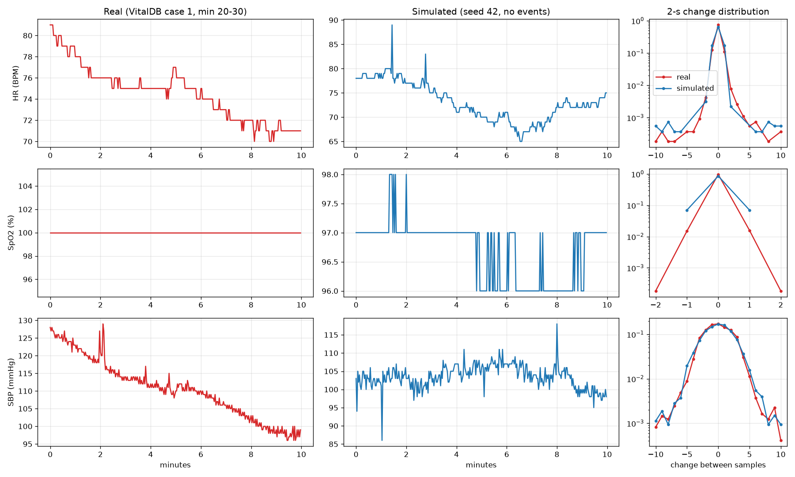

# Vital Signs Monitor

A small IoMT prototype. It simulates vital signs for several patients, filters out noise and outliers at the edge, sorts each patient into a risk level (Normal / Warning / Critical), stores alerts in a database, and shows everything on a live dashboard.

> Status: step 1 is done (patient simulator plus live dashboard). The filtering and alert engine come next.

## Quick start

Requires Python 3.10 or newer.

```bash
python3 -m venv .venv
source .venv/bin/activate
pip install -r requirements.txt
```

Run the two parts in two terminals:

```bash
python -m monitor.simulator            # 3 patients, one reading every 2 s
streamlit run dashboard.py             # opens http://localhost:8501
```

Simulator options: `--patients N`, `--interval SECONDS`, `--seed N` (the same seed gives the same readings and the same events).

Run the tests:

```bash
python -m unittest
```

## Architecture

```
monitor/simulator.py  ──writes──▶  data/monitor.db (SQLite)  ◀──reads──  dashboard.py
        │                              readings, events
        └─ monitor/model.py  (fits the noise model from real data)
```

| Layer | File | Role |
|---|---|---|
| Simulation | `monitor/simulator.py`, `monitor/model.py` | One `Patient` per bedside node. Produces HR, SpO2 and SBP every 2 s. |
| Storage | `monitor/storage.py` | SQLite in WAL mode, so the dashboard can read while the simulator writes. |
| UI | `dashboard.py` | Streamlit. Refreshes every 2 s and shows the last 5 minutes. |
| Config | `monitor/config.py` | Normal ranges, paths and the sampling interval. |

The simulator and the dashboard are separate processes that share only the database. Either one can be restarted without touching the other.

## Simulation model

### Built from real data

Vital-sign behaviour is fitted from a real recording: **VitalDB case 1**. It is about 3 hours of HR, SpO2 and invasive arterial SBP, sampled every 2 s (`real_patient_data/`).

Looking at the real signals, each one is made of **three parts**:

```
reading = slow level  +  jitter  +  occasional spikes
          (drifts over minutes)  (small noise every sample)  (single-sample jumps)
```

We fit the two parts that one recording measures reliably:

1. **Spikes.** A sample counts as a spike if it is more than 5 units from the median of its 7 neighbours (14 s). We record how often spikes happen and keep their real sizes, so the simulator can replay them.
2. **Jitter.** With spikes removed, jitter shows up as neighbouring changes cancelling out (+2 then −2):
   ```
   cov(d[t], d[t+1]) = −jitter_sd²     where d = change between samples
   ```

| Vital | `jitter_sd` | Real spikes | Reading |
|---|---|---|---|
| HR | 0 | ~5 / hour, ±6–13 BPM | The monitor averages HR over beats, so there is no extra jitter |
| SpO2 | 0.09 % | none | Very stable (the real sensor sits at 100 most of the time) |
| SBP | 1.56 mmHg | ~34 / hour, mostly ±6–9, a few −20 to −43 | Small per-beat noise plus line spikes |

The **slow level is an assumption, not a fit.** In this surgical case the trend comes from the operation (SBP 180 → 98, HR 73 → 122), not from how a stable patient drifts. Fitting it gave anything from 0 to 2.2 mmHg per sample, depending on the time scale. So we state it: a stable patient's level wanders about ±4 BPM / ±1 % / ±4 mmHg (1 SD) around baseline, and takes about 5 minutes to wander back.

### How a reading is generated

```
level   += pull * (baseline - level) + N(0, drift_sd)   # slow random walk, gently pulled home
reading  = level + N(0, jitter_sd)                     # fresh jitter, never builds up
reading += a real spike size, with the real spike rate
reading  = round(reading)                              # monitors report whole numbers; SpO2 ≤ 100
```

`pull = 2 s / 300 s`, and `drift_sd` is chosen so that the level's spread settles at the values above. This keeps a stable patient inside the task's normal ranges: **HR 60–100 BPM, SpO2 95–100 %, SBP 90–120 mmHg**. Everything is counted in samples, so `--interval` only changes playback speed, not the simulated patient.

### Realism check

`python -m monitor.compare` plots a calm stretch of the real data next to a simulated patient. It also plots both distributions of 2-second changes:



### Injected events

| Kind | What happens | Duration | Should the system alarm? |
|---|---|---|---|
| `spo2_drop` | SpO2 falls 10–15 points (to about 85 %). HR rises by about 25 to compensate. | 60–120 s | Yes, critical |
| `arrhythmia` | HR jumps about 35 BPM and becomes irregular (±12 per sample) | 30–90 s | Yes |
| `spo2_dip` | SpO2 falsely drops 10–20 points (probe motion) | 1–3 samples | No, filter it out |
| `dropout` | One vital sends nothing (probe off) | 2–5 samples | No |

Each patient averages one clinical event every 3 minutes and one artefact every 30 seconds. The real case has no SpO2 spikes, but motion-induced SpO2 drops are the classic false alarm, so we inject them to test the filter. The natural HR and SBP spikes from the real data are background texture and are not logged. Every event is saved to the `events` table as ground truth. That table lets us measure false alarms and missed alarms later. The detector itself must never read it.

## Assumptions and design decisions

| Decision | Choice | Why |
|---|---|---|
| Source of realism | Fit jitter and spikes from real data; set the slow drift as an assumption | Only one real case exists, and it is a surgical patient (HR up to 120, SBP up to 180). A fitted model keeps the real texture, stays in normal ranges, runs forever, and gives each patient a different baseline. |
| Transport between nodes and the server | Shared SQLite database | No broker to install, and real layer separation. The alerts in step 3 need a database anyway. MQTT would be the production choice. |
| Anomaly timing | Random with a fixed seed | Realistic, yet every run is identical, which is what the report and the demo need. |
| SpO2 drop also raises HR | Yes | Low oxygen makes the heart speed up. That also makes the task's "SpO2 < 90 and HR up = Critical" rule testable. |
| One event at a time per patient | Yes | Keeps the ground truth unambiguous. Can be relaxed later to test artefacts that land during a crisis. |
| Sampling interval | 2 s | Taken from the task statement. It is also the real monitor's (GE Solar 8000M) numeric output rate. |

## Data source

The real patient data comes from **VitalDB**, a de-identified database of surgical patients at Seoul National University Hospital, published under the CC BY 4.0 licence:

> Lee HC, Park Y, Yoon SB, Yang SM, Park D, Jung CW. *VitalDB, a high-fidelity multi-parameter vital signs database in surgical patients.* Scientific Data 9, 279 (2022). https://doi.org/10.1038/s41597-022-01411-5
> Dataset: https://vitaldb.net/dataset · https://physionet.org/content/vitaldb/1.0.0/

`real_patient_data/real_vitals_charts.py` downloads the case and exports the CSV. Running it needs `pip install vitaldb matplotlib`. It is not needed to run the project.
